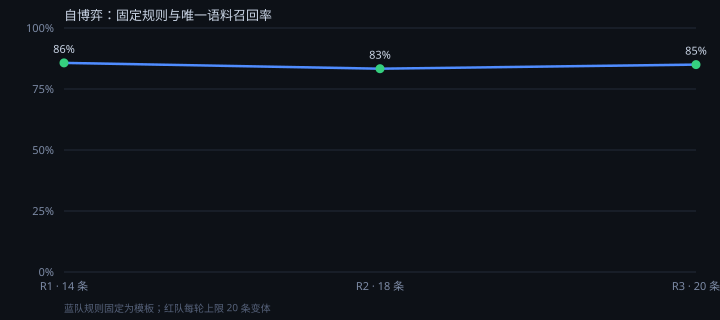

# VulnArena

[](https://github.com/wzjaiykz/VulnArena/actions/workflows/ci.yml)
[](https://www.python.org/downloads/)
[](LICENSE)
[](https://fastapi.tiangolo.com/)

一个可自建、可复现的 **AI 攻防靶场**，同时是一套完整的 **漏洞情报工作台**。

| 模块 | 说明 |
|---|---|
| **情报台** | 同步 NVD 漏洞数据，中文摘要、检索与详情（Vue 3 + FastAPI） |
| **靶场** | 内置企业采购审批系统：10 个接口、7 个可开关缺陷，浏览器里就能真实攻击 |
| **AI 红队** | 按 kill chain 自动推进（DeepSeek 可选，不可用自动降级为确定性链） |
| **AI 蓝队** | 生成的 WAF 规则必须通过「召回 100% + 误杀 0%」的确定性闸门才允许上线 |
| **教学** | 6 个关卡、三级提示、跟练脚本、复盘回放，全部落库可验证 |

三个关键设计：**模型负责提议、确定性负责裁决**；**承认网关的边界**（越权与路径穿越
在网关层无法可靠区分，判定为"只能改代码"并给出对照 diff）；**判据是攻击的副作用**
（canary 是否泄露、数据库状态是否被改），而不是提交一个 flag。

技术栈：Python 3.12、FastAPI、Pydantic v2、SQLAlchemy 2.0（异步）、PostgreSQL 18、
Redis、Vue 3 + Vite。默认单机运行，不连接任何外部目标。

> ⚠️ **仅用于学习与自测**：所有"漏洞"都在进程内的 SQLite 与虚拟文件系统中，
> SSRF 只打进程内的虚拟网络，既不会也不得用于攻击任何真实系统。详见[免责声明](#免责声明)。

## 数据（可复现）

所有数字都能用仓库里的命令重新跑出来，语料与代码在同一个提交里。

### 1. 规则评测：手写 vs 模型生成

| 规则 | 来源 | 召回 | 误杀 | 扫描耗时 | 判定 |
|---|---|---|---|---|---|
| template · sqli | 手写模板 | 100% | 0.0% | 0.073 ms | ✅ 上线 |
| template · ssrf | 手写模板 | 100% | 0.0% | 0.015 ms | ✅ 上线 |
| llm-proposal · sqli | DeepSeek 生成 | 100% | 0.0% | 0.223 ms | ✅ 上线 |

模型一次就写出了能过闸门的规则，但**慢了 4 倍**——它把 `SELECT ... FROM` 也纳入了匹配，
规则更宽、更慢。这就是"能用 ≠ 好用"。

### 2. 自博弈：红队每轮造变体，蓝队召回下降



| 轮次 | 语料规模 | 红队新增 | 蓝队规则 | 召回 | 误杀 |
|---|---|---|---|---|---|
| R1 | 29 | +24 | template | 93% | 0.0% |
| R2 | 49 | +20 | template | 96% | 0.0% |
| R3 | 71 | +22 | template | 96% | 0.0% |

红队只做**确定性等价变形**（`union/**/select`、大小写、空白替换、`union all`、编码），
不需要模型；蓝队规则固定为模板，于是召回逐轮下滑。

换成模型当蓝队（`--llm`）时，模型每轮重写规则，召回能追到 90% 以上，但仍然补不掉那几个点。

**结论**：让模型"提议"很便宜，让它"通过闸门"很贵；而红队永远先手。

### 3. 怎么复现

```bash
python -m vulnarena.bench run                        # 模板规则打分
python -m vulnarena.bench generate --category sqli   # 模型写一条规则并打分
python -m vulnarena.bench selfplay --rounds 3        # 三回合自博弈
python scripts/plot_selfplay.py                      # 重新生成上面的曲线
```

`run` 的退出码就是门禁：有规则没通过就返回 1，可直接挂进 CI。

日常启动、停止、Vue 开发模式与常见报错，见 [中文使用指南](使用指南.md)。
NVD 情报台新增带引用的中文问答、可下载学习卡片、评测和调用看板，见 [NVD AI 使用与设计说明](docs/NVD_AI.md)。
已有前端构建时，启动 PostgreSQL、Redis 和后端即可访问 8000 页面，无需另启前端开发服务器。


## 快速启动（PowerShell）

```powershell
python --version  # 必须是 3.12.x
python -m venv .venv
.\.venv\Scripts\python -m pip install --no-cache-dir -c requirements.lock -e '.[dev]'
if (-not (Test-Path .env)) { Copy-Item .env.example .env }
# Windows 首次配置；已配置的本机使用 postgres.cmd start
.\scripts\postgres.cmd setup
# 先启动本机 Redis，默认连接 localhost:6379；或者修改 .env 中的 Redis URL。
# 当前工作区已配置便携式 Redis 127.0.0.1:6380，可在另一终端运行：
# .\scripts\start-local-redis.cmd
.\.venv\Scripts\python -m uvicorn vulnarena.main:app --host 127.0.0.1 --port 8000 --workers 1
```

打开 [Swagger UI](http://127.0.0.1:8000/docs)。数据库配置使用
`VULNARENA_DATABASE_URL=postgresql+asyncpg://用户:密码@地址:5432/数据库名`，本机库名为
`vulnarena`。连接 URL 在配置对象中以 SecretStr 隐藏，实际密码仅保存在忽略提交的本机文件。
建议始终从项目根目录启动。环境变量优先于 `.env`。可选 NVD API Key 只通过请求头发送。

## Vue 展示界面

本地界面：[VulnArena 工作台](http://127.0.0.1:8000/)。界面读取真实 API，
包含漏洞统计、CVE 编号/描述搜索、严重度和状态筛选、分页、漏洞详情、
全部 CVSS/SSVC 评分、原始数据、参考链接、同步弹窗和任务中心。
没有填充演示数据；数据库为空时展示空状态，服务异常时显示错误与重试入口。
当前浏览器最近 8 个同步任务保存在 localStorage，刷新后可继续查询尚在运行的任务；
该记录不是服务端全局任务历史，也不是可靠队列。轮询中断不会虚构任务失败。

需要 Node.js 22.12+（本机已验证 24.15.0）。首次构建：

```powershell
cd frontend
npm ci
npm run build
cd ..
.\.venv\Scripts\python -m uvicorn vulnarena.main:app --host 127.0.0.1 --port 8000 --workers 1
```

构建输出在 `vulnarena/web/`，由 FastAPI 同源托管；构建后首次启动/重启后端以注册静态路由。
打包 Python wheel 前须先构建前端，wheel 会包含页面与资源；未构建时根路径返回明确的 503 提示，
既有 API 不受影响。无需额外安装或启动 Nginx。

开发模式（后端 8000 已启动，在另一个终端运行）：

```powershell
cd frontend
npm run dev
```

打开 [Vite 开发界面](http://127.0.0.1:5173/)。Vite 将 `/api`、`/health` 和 API 文档请求代理到
`127.0.0.1:8000`，无需放宽 CORS。前端依赖和构建产物已忽略，源码集中在 `frontend/`。
界面使用本机字体回退；可选 Google Fonts 不可访问时不影响功能。外部参考链接仅允许 HTTP/HTTPS。

前端验证：

```powershell
cd frontend
npm test
npm run format:check
npm run build
```

Vitest 测试覆盖真实接口契约映射、空分数与 0 分的区分、参考链接校验、筛选分页、
详情展开、同步校验与状态轮询、成功后刷新、连接中断恢复和服务异常。
这些测试模拟 API，不依赖 NVD 或运行中的后端。Dockerfile 已增加 Node 构建阶段；
CI 会先运行前端测试、格式检查和构建，再运行 Python 检查。

本机安装了 Memurai 时，它是 Redis 协议兼容的 Windows 服务；**不等同于 Redis Open Source**。
官方 Redis 的容器运行方式见下面的 Compose。Windows 环境的实际安装状态见 `VALIDATION.md`。

当前工作区采用 [redis-windows 社区维护的 Redis 8.2.10 Windows 构建](https://github.com/redis-windows/redis-windows/releases/tag/8.2.10)，
位于 `.tools/redis`，不是 Redis 官方 Windows 发行包。下载压缩包已校验发布页的 SHA-256：
`281f180eaba420f43eb18d655197d55bf804eb692bc55209264bfb284da3850f`。
通过 `scripts/start-local-redis.cmd` 在独立终端运行，仅绑定 `127.0.0.1:6380`，
开启 AOF，数据与日志在 `data/redis`，没有安装系统服务或开机启动。
本地 `.env` 已指向该地址（不提交仓库）；新克隆可以使用 Docker 或自行配置 Redis。

Windows 启动与停止：

```powershell
# 窗口 1：启动 Redis，无需修改 PowerShell 脚本签名策略
.\scripts\start-local-redis.cmd
# 窗口 2：启动后端和已构建的 Vue 页面
.\.venv\Scripts\python -m uvicorn vulnarena.main:app --host 127.0.0.1 --port 8000 --workers 1
```

在启动这两个窗口之前，先执行 `.\scripts\postgres.cmd start`。
先在后端窗口按 Ctrl+C，再在 Redis 窗口按 Ctrl+C（如询问是否终止批处理，输入 Y），
最后执行 `.\scripts\postgres.cmd stop`。
已有本地 Redis 响应时，`.cmd` 会提示已运行并退出，不重复启动进程。
原 `.ps1` 入口仍保留，但受 PowerShell 的签名/执行策略约束；推荐使用 `.cmd`，不调整系统策略。

## 操作闭环

```powershell
$task = Invoke-RestMethod -Method Post -Uri http://127.0.0.1:8000/api/sync -ContentType application/json -Body '{"cve_id":"CVE-2021-44228"}'
Invoke-RestMethod "http://127.0.0.1:8000/api/tasks/$($task.id)"
Invoke-RestMethod 'http://127.0.0.1:8000/api/vulnerabilities?page=1&page_size=20&severity=CRITICAL'
Invoke-RestMethod http://127.0.0.1:8000/api/vulnerabilities/CVE-2021-44228
# 手动真实网络验收（不属于测试，也不会在 CI 执行）
.\.venv\Scripts\python scripts/smoke.py
```

`POST /api/sync` 返回 202 + PENDING；稍后查询任务状态至 SUCCESS 或 FAILED。
支持 `{"keyword":"openssl","max_records":100}`；一次最多 1000 条，按 NVD 分页获取。
必须提供 CVE ID 或关键词，不能通过空请求启动全库导入。此版本没有自动增量同步调度。
列表支持 `page`、`page_size`（1–100）、`severity`、`keyword`（CVE 编号、原文或中文描述子串）、
`status`、`topic`、`sort=published|modified` 和 `year_from` / `year_to`。
年份按 **CVE 编号年份** 筛选；首页默认 2020–2026、发布时间降序，可切换单年或全部历史年份。
相同时间按 CVE ID 升序稳定排列。详情从 PostgreSQL 读取。


## 本机 PostgreSQL 管理与旧数据迁移

Windows 使用 `scripts/postgres.cmd setup/start/stop/status/shell/backup/test` 管理本项目实例。
`setup` 首次下载约 385 MB 的 [EDB Windows 二进制包](https://www.enterprisedb.com/download-postgresql-binaries)，
生成随机密码和独立 `vulnarena_test` 测试库。程序位于 `.tools/postgresql`，数据位于
`data/postgresql`，只监听 `127.0.0.1:5432`，采用 SCRAM 认证。本机应用和测试角色均非超级用户。
`start` 在后台启动，不随终端关闭；`stop` 明确停止。中文目录通过 `E:\VulnScopeRuntime\`
下的英文目录联接访问，实际文件仍在项目中。`shell` 打开 psql，`backup` 生成 pg_dump 自定义格式备份。

从旧 SQLite 一次性导入（先停止旧后端）：

```powershell
.\.venv\Scripts\python scripts/migrate_sqlite.py --source .\data\vulnarena.db
```

脚本先通过 SQLite backup API 创建一致备份，再分批校验、Upsert 到 PostgreSQL，并逐条核对字段。
旧 SQLite 保持不变，不再作为运行时数据库；备份在 `data/backups`，报告在
`verification/postgresql-migration.json`。每批原子提交，出错可修正后幂等重跑；不覆盖较新记录。
迁移不复制 Redis 任务历史，数据库新 epoch 会隔离旧缓存。后续数据库变更请勿再使用旧 DATABASE_PATH。

实现依据：[SQLAlchemy PostgreSQL/asyncpg 文档](https://docs.sqlalchemy.org/en/20/dialects/postgresql.html#module-sqlalchemy.dialects.postgresql.asyncpg)、
[PostgreSQL pg_ctl](https://www.postgresql.org/docs/18/app-pg-ctl.html)。

## NVD 数据契约与错误策略

2026-10-25 核对的依据：

- [NVD API 2.0 官方文档](https://nvd.nist.gov/developers/vulnerabilities)
- [官方 JSON Schema（当前标题为 2.2.4，端点仍是 2.0）](https://csrc.nist.gov/schema/nvd/api/2.0/cve_api_json_2.0.schema)
- [配额和最佳实践](https://nvd.nist.gov/developers/start-here)

从 `vulnerabilities[].cve` 读取 `id`、`descriptions`、`published`、`lastModified`、
`vulnStatus`、`metrics`、`references`。优先非空英文描述，其次第一个有效的其他语言描述；
保留 `description_lang`；无描述时使用空字符串并记录 `parse_warnings`。
缺少/无效 ID 或时间、错误响应包裹结构或分页元数据使整个同步失败，不写入半页数据。
无时区的 NVD 时间按 UTC 解释；公共 Pydantic 契约要求带时区；PostgreSQL 使用
TIMESTAMP WITH TIME ZONE，应用存取统一转换为 UTC；原始数据、评分及参考链接使用 JSONB。

列表代表评分选择：**4.0 > 3.1 > 3.0 > 2.0**；同版本中依次优先 `Primary`、
`nvd@nist.gov`，最后按来源字符串排序；完全相同时保留响应顺序。跳过版本不匹配、
非数值、布尔、非有限或超出 0–10 的评分，并记录警告，继续尝试其他版本。
保留 `cvss_version`、`cvss_vector`。严重度按该版本分数区间推导：v3/v4 的 0 是 NONE，
0.1–3.9 LOW、4.0–6.9 MEDIUM、7.0–8.9 HIGH、9.0–10 CRITICAL；
v2 使用 NVD 区间：0–3.9 LOW、4.0–6.9 MEDIUM、7–10 HIGH。
未评分始终为 `cvss_score=null`、UNKNOWN，绝不伪造 0。

Rejected 记录继续保存状态、描述和原始数据，但列表代表评分清空为 null/UNKNOWN，避免误导。
非预期状态字符串保留；缺失状态使用 UNKNOWN。无效可选结构会产生警告并使用空容器。
**完整原始 CVE 对象保存在 `raw`，原始所有评分保存在 `metrics`，包括未知扩展字段**；
因此 SSVC、新增 affected 字段或其他版本不会因代表评分选择而丢失。

HTTPX 默认超时 30 秒，最多重试 3 次（总计 4 次尝试），网络错误、429 和 5xx 才重试，
指数退避 1/2/4 秒；每次尝试（含重试）还必须经过共享节流器。
解析 Retry-After 的秒数/HTTP 日期；等待至少该时长，超过 120 秒则结束并要求稍后重试。
其他 4xx 直接失败。连接异常、上游 HTTP 错误和契约错误为不同异常类型。
官方配额为无 Key 5 次/滚动 30 秒，有 Key 50 次/滚动 30 秒；默认保守间隔均为 6.1 秒，
带 Key 才允许配置到 0.61 秒。此限制适用于当前单实例；共享出口或 API Key 的其他应用
仍会占用上游配额，429 会按上述规则处理。

## 存储、缓存与任务

PostgreSQL 是事实来源；CVE ID 为数据库主键（唯一约束）。Upsert 使用 PostgreSQL 原子
`ON CONFLICT`，新记录插入；修改时间更大或相等时修订字段，较旧记录不覆盖新记录。
相同时间允许上游修正。重复导入不增加重复行，`changed` 为成功执行的写入次数，
包含同一批重复记录和相同内容重写，不表示唯一 CVE 数或业务差异数。
每次同步先获取/解析完整受限结果，再在一个事务写入；异常回滚整批。
AsyncSession 由上下文创建、提交/回滚和关闭。读事务使用 REPEATABLE READ + READ ONLY，
确保缓存修订号、计数和分页结果来自同一快照；写事务使用 READ COMMITTED。
lifespan 初始化由进程内锁和 PostgreSQL 事务 advisory lock 保护，避免不同实例并发建表。
当前只创建缺失表，不自动修改既有表；未来结构升级仍需显式迁移，尚未引入 Alembic。
驱动为 asyncpg，使用连接池与 pool_pre_ping。本机仍默认单 Uvicorn worker。

数据库维护数据修订号和数据库实例随机标识；写入与修订号递增在同一事务。
列表缓存键包含这两项和查询参数；提交后的新查询不会读到旧代缓存，即使 Redis
写入失败也不会持续返回旧数据。旧缓存最多保留默认 60 秒自然过期。
Redis 缓存读取/写入故障时查询回退 PostgreSQL；同步与任务状态依赖 Redis，故障返回 503。

FastAPI BackgroundTasks 是**进程内任务**，不是持久可靠队列。状态流转为
PENDING → RUNNING → SUCCESS/FAILED；有限超时默认 300 秒；状态默认保留 24 小时。
Redis Lua 原子创建状态并获取全局租约；已有待执行/运行任务时返回 409。
租约默认 60 秒，每 20 秒续约；续约失败会取消任务，网络等待结束后写数据库前再次核对所有权。
释放锁只允许当前所有者执行。进程退出、崩溃或 Redis 数据丢失时，不能保证任务已经投递或执行。
租约过期后，读取旧 PENDING/RUNNING 状态会原子标为 FAILED，允许提交新的幂等同步。
没有自动重投；任务异常及正常关闭取消会尽力记录 FAILED。Redis 完全故障时无法保证状态落盘，
待恢复后通过租约判断；状态 TTL 到期返回 404。
DB 提交和 Redis SUCCESS 不是分布式事务；提交后状态更新失败可能显示 FAILED，而数据已写入，
可安全重新同步。此方案以单 worker 学习为边界，没有声称解决生产多 worker 或可靠投递。
未来需要持久调度、跨进程恢复时再引入独立 Worker 与可靠队列。

## 演练场（AI Cyber Arena）

同一个进程里，`/api/procure/*` 是一套故意做坏的采购审批系统（角色、金额阈值、三级审批），`/api/arena/*` 是观测入口。
靶场数据全在内存 SQLite 与虚拟文件系统里，**不碰 PostgreSQL 里的漏洞库，也不发起任何外网请求**。
边界与取舍见 [ADR-001](docs/ADR-001-core-vs-arena.md)。

一条命令跑完整闭环（不需要 PostgreSQL / Redis / 网络）：

```powershell
.\.venv\Scripts\python scripts/arena_demo.py
```

四个阶段：

1. **布防**：开启 2 个组合缺陷（`sqli_union_search` + `idor_ticket_detail`），并预置一条"年久失修"的网关规则；
2. **攻击链**：基线探测 → 朴素 payload 被拦（403）→ `UNION ALL` 变形绕过拿到 canary → 低权限账号越权读高管工单；
3. **修复**：模板规则过闸门（召回 100%、误杀 0%）后写入策略，同时把缺陷开关切回安全实现，并渲染代码 diff；
4. **回归**：重放攻击链（全部 403）+ 7 条正常业务（全部 200 且不含 canary），双断言通过才判 `VERIFIED`。

规则为什么必须过闸门：闸门要求正则在 12 条 benign 语料上零误杀、在攻击语料上全召回，否则一条 `'`
的规则就会把 `O'Brien` 的正常查询打掉。路径穿越与 IDOR 被判定为**只能代码修复**——正常备注里也会
出现 `../`，正则无法区分攻击与抱怨。

观战接口：`GET /api/arena/stream/{session_id}`（SSE），主核只做只读转发，不解释内容。

## 测试与 CI

```powershell
.\.venv\Scripts\python -m ruff check .
.\.venv\Scripts\python -m ruff format --check .
# 本机完整测试：读取本机 .env 的测试库 URL，不打印密码
.\scripts\postgres.cmd test
# 其他环境需显式配置 TEST_DATABASE_URL（postgresql+asyncpg://.../vulnarena_test）
# 和 TEST_REDIS_URL（本机 6380/15，CI 6379/15）
.\.venv\Scripts\python -m build --no-isolation --outdir verification/packages
```

测试包括数据契约、四代 CVSS、缺失/异常字段、多语言、Rejected、HTTPX MockTransport
解析、429/5xx/连接超时/重试与虚拟时钟节流、PostgreSQL 唯一约束/Upsert/回滚、
FakeRedis Lua 状态和并发互斥、真实 Redis 集成、FastAPI lifespan 接口闭环、任务异常、
超时/取消/续约失败、缓存失效与 Redis 降级。数据库测试使用独立随机 schema 和异步生命周期，结束后只清理自己的 schema。
测试禁止连接非本机网络；NVD 请求全部模拟，CI 不依赖真实 NVD。
未设置 TEST_DATABASE_URL 时，数据库集成测试明确跳过，只接受名称以 `_test` 结尾的
独立 PostgreSQL 测试库。未设置 TEST_REDIS_URL 时，真实 Redis 测试跳过。跳过不代表通过。
pytest-cov 强制 80% 覆盖率。CI 执行 Ruff、格式检查、完整测试/PostgreSQL/Redis 服务、覆盖率门禁、
Python 打包、Docker 构建、容器健康及非 root 检查。**这是 CI，尚无生产部署流程。**

测试报告统一位于 `verification/`（覆盖率 XML 为 `verification/coverage.xml`）；
pytest/Ruff 缓存在 `.tools/cache/`，测试临时文件在 `.tools/tmp/pytest/`。
开发期间的安装残留和旧构建产物已归档在 `.tools/cleanup-archive/`，与源码分开存放。

## Docker

本机现已安装 Docker Desktop 4.96.3、Docker CLI 29.9.2、Compose 5.6.1 与 WSL 2.7.14，
Compose 配置校验已通过。Windows 功能仍提示需要重启；按当前远程连接使用要求，
没有重启电脑，也没有启动 Docker 引擎。本机页面使用 Python + PostgreSQL + 便携式 Redis 服务。
以下容器启动命令须等系统条件满足且你准备启用容器时再执行，不代表已完成容器运行验收。

```powershell
docker compose up --build -d --wait
docker compose logs -f api
docker compose down  # 保留数据卷
```

多阶段 Dockerfile 使用 Python 3.12，运行用户 UID/GID 10001，单 Uvicorn worker 和健康检查。
Compose 包含 PostgreSQL 18，`postgres-data` 卷映射 `/var/lib/postgresql`（18 的卷布局）；
Redis AOF 使用独立 `redis-data` 卷。两个数据库均不对宿主机公开端口。
首次空卷初始化脚本创建普通应用角色；管理员与应用密码分别设置 POSTGRES_ADMIN_PASSWORD、
POSTGRES_PASSWORD。建议使用随机十六进制密码，避免 URL 特殊字符；本机 setup 已生成。
初始化脚本仅在空卷运行，修改 .env 不会自动更改已有数据库角色密码。
需要本机测试 Redis 时可单独运行：

```powershell
docker run -d --name vulnarena-test-redis -p 127.0.0.1:6379:6379 redis:7.4-alpine
```

已有本机 Redis/Memurai 使用 6379 时不要重复绑定同一端口，可改为 6380 并调整测试 URL。
Windows 首次启用 WSL/虚拟机平台需要管理员权限：

```powershell
# 管理员 PowerShell；脚本不自动重启
powershell -ExecutionPolicy Bypass -File .\scripts\enable-container-features.ps1
# 手动重启 Windows 后
.\scripts\setup-containers.ps1
```

不要提交 `.env`、API Key、数据库、运行日志或 `.tools` 内的安装包。
当前工作区初始只有 5 个 IDE 文件，无源码和原始文件清单；实际项目文件清单与验证见 `VALIDATION.md`。

## 多生态数据与双语学习资料（2026-10-28）

情报库现在支持 Linux、Windows、Java、Go、Python、PHP、C/C++、.NET、Rust 和 JavaScript
等生态筛选；标签来自描述、产品和包信息的文本线索，同一记录可以属于多个生态，不代表已验证实现语言。
搜索可匹配 CVE 编号、英文描述、公告标题和已保存的中文摘要。列表按最近修订或最近发布排序。

打开漏洞后默认进入「双语学习资料」：

- 中英对照 / English / 中文切换，直接阅读本地保存的正文，无需逐个打开外部链接。
- 展示 CNA 产品、版本状态、上下界、版本状态变更，以及 GHSA 包范围和首次修复版本。
  `unknown`、`unaffected`、`defaultStatus` 保留原样，不把未知状态视为安全。
- 本地公告包括 CVE CNA 的描述、影响、解决方案、缓解措施，以及 GitHub 公告全文；
  对允许采集的厂商站点尝试抽取静态正文。JavaScript 动态页面、robots 限制、403、网络失败
  会作为来源缺失提示保存，不伪造正文。每篇最多下载 2 MB、保存 80,000 字符，截取会明确标注。
- 「下载学习包」返回 ZIP，包含原始记录 JSON、学习资料 JSON、双语摘要和每篇中英 Markdown。
  学习包始终来自本地数据库；下载不会临时请求来源站点。
- 新增 `vulnerability_studies`、`study_translations` 两张表，启动自动创建；原 vulnerabilities 表无需改列。
  原始 NVD 对象与补充资料分开存储，补采后同步更新列表缓存版本。

### 离线翻译

本工作区已配置离线英文到中文模型。新环境配置：

```powershell
.\.venv\Scripts\python -m pip install -c requirements.lock -e '.[translation]'
.\.venv\Scripts\python scripts/setup_translation.py
```

模型约 71 MB，来自 [Argos 官方模型索引](https://github.com/argosopentech/argospm-index)，
下载后验证固定 SHA-256。原始 OPUS-MT 模型采用 CC-BY 4.0，模型目录保留作者 README。
使用 CTranslate2 和 SentencePiece 推理，有可用 CUDA 时优先使用 GPU，否则回退 CPU。
不加载模型 Python 代码或 pickle。代码围栏内内容保留英文代码；译文为机器翻译，需结合原文核对。
模型位置可通过 `VULNARENA_TRANSLATION_MODEL` 设置，默认 `data/models/translate-en_zh-1_9`。
线上 gtx 翻译仅作为实验选项，默认关闭；限流后本实例停止继续请求，不绕过限制。

### 批量扩库与断点续跑

```powershell
# 每个关键词最多100条，另取各包生态最近50条GitHub公告，优先抓近期记录并补采详情
.\.venv\Scripts\python scripts/refresh_library.py --per-topic 100 --advisories 50 --curated --enrich-limit 5000 --references 0
# 补采本地库，复用已有正文与翻译缓存，不再同步NVD
.\.venv\Scripts\python scripts/refresh_library.py --skip-fetch --enrich-limit 5000 --references 0
# 为经典案例额外尝试厂商正文和GitHub详细公告
.\.venv\Scripts\python scripts/refresh_library.py --skip-fetch --only-curated --references 2 --force --report verification/curated-enrichment.json
```

脚本使用固定并发（1–4）、NVD 节流、有限下载大小和 HTTPS 公告域名白名单；
逐条提交，已完成的内容在中断后仍保留。`--references 0` 表示采集结构化 CNA/GHSA 公告，
不抓额外网页；1–3 表示每条最多额外尝试的参考网页数量。
无来源提供的根因、补丁或受影响版本不会由程序自行编造。`--only-missing` 跳过已补采且有中文摘要的记录。

日志与报告分别在 `verification/`，GitHub 原始公告缓存在 `data/advisory-cache.json`。
同一数据库不要同时运行多个完整批量任务；少量不同案例的补采可以并行。
GitHub 仅导入带 CVE ID 且未撤回的已审核公告；已存在的记录保留其 NVD 来源，避免混淆来源。

新增 API：`GET /api/topics`、`GET /api/library/stats`、
`POST /api/vulnerabilities/{id}/enrich`、`GET /api/vulnerabilities/{id}/download`。
列表新增 `topic`、`sort=published|modified`；同步新增 `latest`、`recent_days`、`enrich`。
包含正文与翻译的 API 同步限制每批20条，较大批量使用脚本；后台任务仍为进程内任务，重启后可重新发起。
列表不再返回 raw/metrics/references 大字段，完整内容通过详情接口读取。

实现依据：[GitHub Global Advisories API](https://docs.github.com/en/rest/security-advisories/global-advisories)、
[CVE JSON Schema](https://github.com/CVEProject/cve-schema)、
[CTranslate2 Translator](https://opennmt.net/CTranslate2/python/ctranslate2.Translator.html)。

## NVD 全库批量导入（2026-10-29）

关键词采集适合选题学习，不能覆盖几十万条 CVE。全库初始化使用 NVD 官方 JSON 2.0 年度数据包：

```powershell
.\.venv\Scripts\python scripts/import_nvd_feeds.py --start-year 2002 --end-year 2026 --batch-size 500 --pause 0.25 --recent-days 8
```

NVD 的 2002 年数据包同时收录更早年份的历史编号；包按官方年份组织，不按语言或系统过滤。
脚本默认从最近年份开始，每次只解析、写入一小批记录。下载使用最多两个连接、每块 1 MiB，
数据库写入单路进行；Windows 采集进程使用低于正常的调度优先级。`--pause` 可增加批间等待。
此命令不启动公告抓取、离线翻译或 GPU 推理。

每个年度文件在解压后的 JSON 上校验官方 `.meta` 声明的 SHA-256 和大小，校验通过后才允许导入。
压缩包缓存在 `data/nvd-feeds/`；网络中断保留连续的已下载片段，完整性错误会重新下载。
解析使用 ijson 流式读取，不把整个年度 JSON 放进内存。

每批漏洞写入与断点在同一个 PostgreSQL 事务提交，进度保存在 `nvd_feed_checkpoints`。
关闭后重新运行同一命令会续跑；上游文件未改变且已完成的年份会跳过。
CVE ID 唯一，新数据不会新增重复行，较旧来源修改时间不会覆盖较新记录；已有学习资料独立保留。
同一数据库同时只允许一个全库导入进程。最后按时间窗口补充 API 的近期修改。

任务报告：`verification/nvd-bulk-import.json`；控制台日志可自行重定向到 `verification/nvd-bulk-import.log`。
`status=partial/failed/interrupted` 时查看失败年份并重跑，不把部分导入视为全库完成。
导入过程中可以在前端点击「刷新」查看实际已入库数量。

新增记录保留 NVD 英文描述、所有评分、CWE、CPE 受影响配置、引用和完整原始 JSON。
尚未补采的记录可直接从现有 NVD 数据显示版本范围和 CWE。中文摘要使用下面的独立批量任务；
厂商公告正文另行按需补采，因此全库数量、中文摘要数量和本地正文数量分别统计。

### 2020–2026 年整理与中文摘要

```powershell
.\.venv\Scripts\python scripts/translate_descriptions.py --year-from 2020 --year-to 2026 --batch-size 256 --pause 2
.\.venv\Scripts\python scripts/audit_chinese_coverage.py
```

批量任务按 CVE 编号年份处理缺失译文，低进程优先级、单路批量推理、逐批保存；
有 CUDA 时使用 GPU，否则使用 CPU。重新执行会跳过已有且与当前英文相符的摘要，
不会重抓官方数据，也不会启动数十万个单条后台任务。运行控制及报告位置见中文使用指南。

新增 `chinese_descriptions` 表，中文摘要与英文描述 SHA-256 绑定；评分等其他元数据更新
不会误伤有效译文。`GET /api/library/years` 返回年度收录和当前中文覆盖，列表支持年份筛选与中文搜索。
详情缺少当前中文时调用 `POST /api/vulnerabilities/{id}/translate`，随后通过
`GET /api/vulnerabilities/{id}/translation` 查询状态；每个后端进程最多排队 32 条，完成后持久化。
前端会自动执行这个流程，英文原文、中文摘要与已采集公告分别展示，学习包使用最新有效摘要。
译文为机器翻译，不替代英文原文或厂商修复公告。

官方依据：[NVD 数据源](https://nvd.nist.gov/vuln/data-feeds)、
[NIST NVD 数据包说明](https://www.nist.gov/itl/nvd)、
[ijson 流式解析](https://github.com/ICRAR/ijson)。

## 免责声明

本项目是一个**教学与自测用途**的安全演练环境，请在阅读并理解以下条款后使用。

1. **适用范围**：项目中的"靶标"是一套运行在进程内的模拟企业采购系统，
   漏洞由代码中的开关显式控制；所有攻击流量只作用于该进程内的 SQLite 数据库、
   虚拟文件系统与虚拟网络，**不包含任何真实系统的利用代码，也不针对任何外部目标**。
2. **合法使用**：本项目仅可用于个人学习、教学演示、以及**你拥有明确书面授权**的
   自有系统测试。未经授权对他人系统进行扫描、探测或攻击，在绝大多数司法辖区
   均属违法行为。使用者应自行确认其行为符合所在地法律法规。
3. **禁止用途**：不得将本项目的任何部分用于未经授权的渗透测试、恶意攻击、
   数据窃取、规避安全产品，或任何危害网络安全的活动。
4. **无担保**：本项目按"现状"提供，不附带任何明示或默示的担保，
   包括但不限于适销性、特定用途适用性与不侵权担保。作者不对使用本项目
   造成的任何直接或间接损失承担责任。
5. **AI 生成内容**：项目中的攻击步骤与防御规则可能由大语言模型生成，
   可能存在错误、遗漏或不适用于真实生产环境，**不得直接用于生产系统**。
6. **数据来源**：漏洞情报来自 NVD 等公开数据源，版权归原始发布方所有；
   本项目仅做本地缓存与索引，不主张其所有权。
7. **责任**：使用者须自行承担使用本项目产生的全部风险与责任。
   如不同意上述条款，请立即停止使用并删除本项目副本。

## 许可证

本项目采用 [MIT License](LICENSE) 发布。
