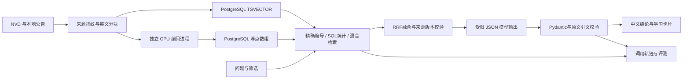

# NVD AI 学习工作台

本模块为漏洞情报台增加三个功能：带英文原文引用的中文问答、结构化漏洞学习卡片、可复现的检索评测与调用看板。不涉及靶场、采购系统或红蓝对抗逻辑。

## 从哪里使用

访问 http://127.0.0.1:8000/，左侧选择 **AI 情报助手**。问答页支持关键词、语义和混合检索，以及年份、生态、严重度筛选。点击回答旁的引用可定位英文证据，继续打开本地 CVE 详情。类似“2024 年 Python 高危漏洞有多少条”的问题由数据库计数；可以直接进入对应列表。

在 CVE 详情的 **AI 漏洞学习卡片** 中，点击生成后得到问题、触发条件、影响、修复依据和学习要点五部分。缺少证据的部分明确标记。可单独下载 Markdown；当前版本卡片也会加入原有学习资料 ZIP，包含 JSON、Markdown 和英文来源。

**质量与调用** 展示实际 token、延迟、缓存命中、校验拒绝、模型调用和参考费用。可以执行 100 题检索评测、比较三种检索、展开生成抽查并下载完整 JSON。默认仅检索，不调用付费模型；勾选生成抽查额外调用最多 5 次。后台任务可停止，已落库索引可复用。

## 数据边界

- 本机完整库目前 416,287 条，2020–2026 年共 270,587 条。精确 CVE 编号检索和统计读取完整库。
- 语义索引按本机低负载预算建立，覆盖 2020–2026 年的选定记录和已下载资料。规模、当前有效条数、旧版待升级数量及来源契约以 `/api/ai/status` 和页面为准；不能保证自然语言检索覆盖完整库。
- 原始英文描述与已下载公告是事实依据；中文机器翻译辅助阅读。GitHub Advisory 记录保留自身来源，不冒充 NVD。
- 引文校验验证来源 ID 与英文引文是否真实出现在本地证据中，**不等于验证中文结论一定由引文推出**，也不验证上游公告正确性。生成抽查保留待人工复核状态。
- 资料未给出的受影响版本、修复版本、利用条件，不作为已知事实补齐；历史公告避免冒充实时状态。

## 架构与取舍



关键词使用 PostgreSQL `simple` 全文检索；语义使用多语言 E5 small int8，查询/文档分别带对应前缀。向量归一化后由 NumPy 精确余弦扫描，再与关键词用 RRF（k=60）融合。没有使用 BM25、pgvector 或近似向量索引，适合当前有界索引；扩大到完整库应先测内存和延迟，再迁移向量后端。

来源指纹包含英文记录、元数据和本地公告。更新后旧证据被排除，旧卡片显示需重生成；缓存还绑定提示词、模型和证据版本。模型没有工具执行权限，抓取内容被当作数据。SSE 先报告检索/生成进度，仅展示通过校验的完整答案。

ONNX 使用独立 Python 进程和依赖，原生库崩溃不会直接拖垮 FastAPI。默认 CPU 2 线程、批量 8、索引批次停顿 0.25 秒，空闲 120 秒卸载编码器。正则匹配使用可终止子进程，与模型和编码器隔离。模型生成并发 1、超时 75 秒、输出上限 2,200 token，每日默认最多 30 次，按 UTC 日计数，失败的已预留调用也占额度。当前只支持一个 Uvicorn worker；索引任务参数落库，意外退出或正常停机中断后会自动续跑并复用已保存记录；手动取消不自动重启。付费生成评测不自动恢复。启动时用数据库会话锁阻止误开第二个 Web 实例；仍不是分布式执行队列。

## Windows / Python 3.12 复现

先按主指南配置 PostgreSQL、Redis 和 `.env`，保留现有本机数据库、端口及密钥，不覆盖成示例值。

```powershell
.\.venv\Scripts\python -m pip install -c requirements.lock -e '.[dev,ai]'
.\.venv\Scripts\python scripts/setup_ai_runtime.py
.\.venv\Scripts\python scripts/setup_ai_embedding.py
cd frontend
npm ci
npm run build
cd ..
.\.venv\Scripts\python -m uvicorn vulnarena.main:app --host 127.0.0.1 --port 8000 --workers 1
```

运行时脚本按 `requirements-ai.lock` 安装完整隔离依赖，验证 PyPI wheel SHA256 并写 manifest。编码模型 `Xenova/multilingual-e5-small` 固定 revision `761b726dd34fb83930e26aab4e9ac3899aa1fa78`，校验下载，不执行远程 Python 或 pickle。首次安装需下载；日常仅读本地模型。不要在主环境导入 ONNX。安装脚本支持 Python 3.12 的 Windows/Linux 平台 wheel 选择，并按平台跳过 Windows 专用依赖。Windows 路径为 `.tools/ai-runtime/Scripts/python.exe`，Linux 为 `.tools/ai-runtime/bin/python`。容器可使用 `--target ai` 与 `compose.ai.yaml`，模型目录单独只读挂载；另有手动 Linux CPU smoke workflow。本机 Docker 引擎未启动，因此本轮没有宣称已经完成 Linux 容器运行验收。

复制 `.env.example` 的 `VULNARENA_AI_*` 到现有 `.env`。专用密钥、地址和模型留空时沿用已有 DeepSeek 配置。显式问答生成、卡片生成及勾选的生成评测会发送问题与公开漏洞片段到配置模型服务；浏览、建索引、检索评测、下载不调用大模型。密钥不得提交 Git。

本机 NVD 模型为 `deepseek-flash`。费用按实际 token 与配置参考单价估算，币种 USD；当前以公开峰时输入未命中缓存 0.30、输出 1.20 美元/百万 token 作参考上限，未计缓存及非峰时折扣，不代表账单。未配置价格的历史请求显示未知，不倒填为零。参考：[官方定价](https://api-docs.deepseek.com/quick_start/pricing/)。官方服务显式关闭 thinking 来控制输出预算，参见[官方说明](https://api-docs.deepseek.com/guides/thinking_mode/)。

来源契约升级为全文公告分块；旧版索引会自动低负载更新，平时无需重复重建。问答按问题选择证据，卡片最多选择八段，避免把全部公告塞入提示词。显式技术名称约束用于减少不同产品的同类漏洞混入。页面“构建/更新索引”会复用来源和模型都未变化的记录。

## 评测与求职展示

开发集由 20 个核对来源的 CVE 种子，各构造精确编号、英文、中文、改写四种问法，再加入 10 个不存在编号、10 个领域外问题，共 100 题。这不是 100 份独立人工标注或无泄漏泛化测试集。前端单独展示 60 道自然语言正例的 Recall@5、MRR，精确编号题另列；负例、跳过和失败案例分别保存。不能将简单负例通过率宣传为“无幻觉率”。

报告保存题集版本、索引指纹、数据修订号、模型配置、每题候选/名次/耗时、可选生成全文及引用。生成评测强制绕过答案缓存；仍需人工判断结论与引文的语义支持关系。调用看板汇总最近 1,000 条轨迹，明确显示窗口。

2026-10-29 本机开发基线（同一 5,000 条索引，60 道自然语言正例，无跳过）：

| 检索方式 | Recall@5 | MRR |
|---|---:|---:|
| 关键词 | 88.33% | 0.7903 |
| 语义 | 83.33% | 0.7992 |
| 混合 RRF | 86.67% | 0.8500 |

关键词召回更高、混合排序更好，不宣称混合方式所有指标都胜出。20 个简单负例三种模式均无返回证据；5 次真实生成抽查为 4 个完整回答（引文位置通过）、1 个无可用依据的拒答（没有引文，不计校验通过），语义仍待人工复核。生成评测遇到前台模型请求会排队等待，保持生成并发为 1。

演示顺序：中文跨语言检索 → 英文引文定位 → 本地 CVE 五段学习卡片 → 缺证据标记 → 下载 → 三种检索比较与失败案例 → token、缓存及版本追溯。简历可据实写：

> 在 FastAPI + Vue 漏洞情报系统中实现带原文溯源的 RAG 问答及结构化学习卡片；使用 PostgreSQL 全文检索、多语言 E5 和 RRF 融合，实现来源版本失效、输出结构及引文位置校验、调用预算和低负载 CPU 编码；构建 100 题开发评测，记录 Recall@5、MRR、延迟、token 和参考费用。

分数以实际报告为准，明确当前有界语义索引的实际记录数。后续可扩展独立人工测试集、重排及向量后端；当前没有训练或微调基础大模型。

## 接口与验证

`/api/ai` 下提供 `status`、`index`、`jobs/{id}`、`jobs/{id}/cancel`、`search`、`ask`、`ask/stream`、`cards/{CVE}`、`cards/{CVE}/download`、`dashboard`、`traces`、`evaluations`，参数见本机 `/docs`。评测不修改原始 CVE 数据。

新增测试覆盖缓存/来源失效、假引文拦截、预算、SSE、卡片下载、任务取消、原生进程故障隔离、检索与评测持久化，前端覆盖流、错误保留、卡片和原有交互。数据库测试使用独立测试库，不清理真实漏洞库。验收文件保存在本机忽略提交的 `verification/`。

## 留出集与人工评审

原 `nvd-holdout-25-v1` 首测发现领域判断漏判，已用于诊断并重新归类为“扩展回归”，不能再宣传成盲测。新冻结 `nvd-holdout-25-v2` 使用另十个与开发集、回归集均不重叠的 CVE：中英文各一题，加五个虚构产品负例。题目由助手依据本地 NVD 英文描述编写核对，**尚不是独立人工标注**。v2 首测自然语言 Recall@5 为 90%，混合 MRR 0.9000，仍保留两个漏检问法；没有根据这一结果继续改题刷首测分数。将公开 CVE 资料放入检索知识库属于正常检索场景；测试问答未进入生成训练。报告区分别保存题集、版本、索引指纹和逐题结果。

2026-10-30 的实际范围为 5,018 条 CVE / 6,888 段原文。开发集自然语言 Recall@5：关键词 88.33%、语义 85.00%、混合 88.33%；混合 MRR 0.8556。五次强制新生成全部完整返回，引文位置检查通过，语义仍待人工核对。昨天的表格保留为历史基线，索引不同，不能将差值归因于单项改动。完整结果、限制与五分钟演示流程见 [修整报告](REPAIR_REPORT.md)。

生成抽查可以下载人工评审 JSON：核对中文结论、英文证据及版本条件后填写 reviewer、verdict、source_ids、explanation，并把 evidence_reviewed 改为 true，再导入。服务端拒绝未知回答/来源、空理由和未确认核对的条目；记录追加时间及“人工自行声明”的评审方式，不篡改模型原始答案，也不伪造人工准确率。界面会显示登记的结论，未复核仍显示待人工复核。

`python scripts/evaluate_retrieval.py` 在同一份索引、同一开发集上比较技术名称约束开/关，不调用大模型；索引或数据在实验中变化则拒绝产出对比。`python scripts/benchmark_api.py` 串行测量本机 API 的 P50/P95，剔除每个端点的两次预热，并保存每次观测和请求编号；后台索引/评测未结束时拒绝开始。不要把昨天不同索引的分数差值归因给单项算法。
