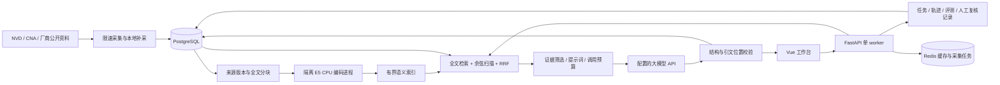

# 求职项目修整报告

验收日期：2026-10-30。当前代码定位为单机安全学习与验证工作台，重点是 NVD 双语资料、证据检索、AI 学习卡片和可追溯评测。原始漏洞库保留，没有用演示数据替换真实数据。

## 本轮改动

| 原问题 | 修整后的行为 |
|---|---|
| 公告只索引前面少数片段，修复条件可能在后文 | 所有已保存、有效的英文正文分块入库；问答与卡片另按问题和章节挑选有限证据，避免无限增长提示词 |
| 中文混合技术名查询混入其他产品，部分安全问法被过早拒绝 | 增加技术名称限定及别名展开，修正领域判断的常见漏判，并保留逐题失败记录；领域启发式仍有边界 |
| 来源变化后旧索引和卡片容易混用 | 来源契约、提示词、索引和构建版本可查；旧来源排除，卡片过期需重生成 |
| 后台索引中断后难判断是否续跑 | 参数落库，停机中断可恢复，已完成记录复用；手动取消和收费生成评测不会自动重跑 |
| 只有单一开发题集，引用位置通过容易被当作回答正确 | 区分开发、扩展回归与留出集；保存答案原文，提供人工语义复核 JSON 导出/导入，未复核保持 pending |
| 运行数据缺少关联信息 | 请求 ID 关联问答轨迹，记录版本、耗时、token、缓存和参考费用；P50/P95 脚本保存原始观测 |
| 写操作和模型调用没有访问边界 | 空口令仅允许本机；可选签名管理登录与请求头认证，跨站写入检查，登录失败限流 |
| 表结构只有自动建表 | 接管现有基线，增加带校验和的版本 SQL 迁移；发现改写的历史迁移或较新数据库版本时拒绝继续 |
| 自博弈变体重复计数，CLI/API 基线不一致 | 归一化去重，分别展示候选数和唯一新增数；共享每轮候选上限，固定配置可复现 |
| 正则在线程中超时后可能继续消耗 CPU | 匹配放入可终止子进程，硬期限终止并等待回收；异常或超时不放行 |
| 演练报告只在内存，多个操作共用沙盒可能冲突 | 报告落库，中断标记；运行、恢复和修复操作互斥；确定性演示零模型调用，模型预算按会话计数 |
| Linux AI 镜像缺少运行时 | 提供平台依赖选择、隔离 CPU 运行时、可选 AI Docker target 与手动 CI 验证路径；本机未运行 Linux 容器 |

`/lab` 页面已从 Python 大段 f-string 拆到标准库模板。自博弈使用表单 POST → 303 → 服务端表格及 SVG，不依赖这部分 JavaScript。

## 架构与边界

自然语言语义检索覆盖有界子集，并非几十万条全库向量化。精确 CVE 编号和结构化统计可查询全库。关键词为 PostgreSQL simple 全文检索，向量用 NumPy 精确余弦扫描，融合为 RRF；没有把它包装成 BM25、ANN 或训练过的模型。

独立 ONNX 进程默认 CPU 两线程，索引串行低负载运行，空闲 120 秒卸载。模型生成并发为一，默认每日 30 次。共享内存沙盒只允许串行操作；数据库会话锁防止误开第二个 Web，但这不是分布式任务系统。重启恢复的是报告，不是正在运行的沙盒。

## 真实检索评测

本轮来源契约 `nvd-evidence-v2-full-documents`、提示词 `grounded-nvd-v3`、检索 `hybrid-technical-anchors-v2`。索引为 **5,018 条 CVE / 6,888 段原文**；每次构建上限是本次候选范围，已保存的其他有效记录会保留，因此总量可以略超 5,000。

| 题集 | 自然语言正例 | 关键词 Recall@5 / MRR | 语义 Recall@5 / MRR | 混合 Recall@5 / MRR |
|---|---:|---:|---:|---:|
| 开发集 nvd-study-100-v1 | 60 | 88.33% / 0.8153 | 85.00% / 0.8194 | 88.33% / 0.8556 |
| 扩展回归 nvd-holdout-25-v1 | 20 | 100% / 0.9500 | 100% / 1.0000 | 100% / 1.0000 |
| 新留出 nvd-holdout-25-v2 首测 | 20 | 90% / 0.8250 | 90% / 0.8750 | 90% / 0.9000 |

所有模式均无跳过。开发集还有 20 道精确编号题与 20 道负例；两个 25 题集各有五道虚构产品负例。负例检索无返回不等于模型无幻觉。开发集来自 20 个 CVE 的多种问法，不能称为 100 份独立人工标注。

原 v1 留出集首测自然语言召回只有 60%，暴露领域判断漏判。用于诊断后已改标扩展回归，旧分数仍保留。另用不重叠的十个 CVE 冻结 v2 再首测；v2 的两个失败问法及原始结果保留，不为提高首测分数反复改题。这些题目由助手按本地 NVD 原文编写核对，尚无独立人工标签；每题只标一个目标 CVE，也没有穷举所有相关 CVE。

五次绕过缓存的真实生成全部返回完整答案，引文位置检查通过，**语义支持关系仍待人工复核**。评审模板保持空白，不把助手的判断记成真人评审。

具体报告可在页面“AI 情报助手 → 质量评测与调用”选择。完整逐题结果及本机验证文件位于被 Git 忽略的 `verification/`。

## 自博弈口径

| 回合 | 唯一语料 | 产生候选 | 唯一新增 | 召回 | 误杀 | 闸门 |
|---|---:|---:|---:|---:|---:|---|
| 1 | 14 | 20 | 9 | 85.71% | 0% | REJECT |
| 2 | 18 | 20 | 4 | 83.33% | 0% | REJECT |
| 3 | 20 | 20 | 2 | 85.00% | 0% | REJECT |

CLI 与 API 的逐轮数据一致。固定模板和输入使结果重复且很快，这是离线规则压力实验，不是强化学习或模型参数训练。文本变体并未全部在真实数据库执行验证等价性，召回仅说明当前文本语料上的规则覆盖。

## 验证结果与性能

- 最终后端全量：254 passed、2 skipped，覆盖率 86.17%；两项需要独立真实 Redis 测试库的集成测试未在本机执行。前端 24 项测试通过，格式检查、Vite 构建、Ruff 与 wheel 构建通过。
- wheel 已核对包含静态页面、lab 模板、迁移 SQL 与两个留出/回归题集；没有向仓库上传模型、密钥或真实数据。
- 真实首页、健康检查、API 文档及 AI 状态均返回 200。服务重启后会话 `13a148de`、关卡进度与自博弈结果一致；该次确定性演练状态 VERIFIED，模型调用 0。
- Log4j 新卡片五段生成完整，MD 下载和包含四组中英文公告、AI 卡片的 ZIP 学习包通过校验。无证据和领域外问题不消耗模型额度。
- Windows 隔离 CPU 运行时真实输出 384 维向量，中英文相关证据相似度 0.8718，高于无关文本 0.7664；不是只检查依赖是否安装。

同一索引和开发集上的技术名称约束消融：自然语言 Recall@5 开/关均为 88.33%，MRR 从 0.8533 到 0.8556，提升很小，不能宣称显著改善。执行顺序和预热不同，耗时差异不用于推断该策略的性能收益。

串行 API 测量每端点 20 次、各剔除两次预热，不调用生成模型；保留每次观测和请求 ID。测量构建 `4071b208b3c0`，最终构建 `18406c4ffb64` 仅另补新卡片即时响应元数据与报告题集标签，未重复宣传为新一轮算法提升。测量时系统存在其他程序负载，结果不能当并发压测或独占机器容量。

| 端点 | P50 ms | P95 ms |
|---|---:|---:|
| 健康检查 | 4.00 | 4.56 |
| 漏洞分页 | 6.97 | 8.42 |
| 全库学习资料统计 | 1969.87 | 2453.23 |
| CVE 详情 | 20.35 | 23.64 |
| 混合检索 | 114.29 | 182.14 |

资料统计仍需约两秒，属于下一步明确的性能优化项；没有把它隐藏在总体平均值中。原始文件：`verification/api-benchmark.json`、`retrieval-ablation.json`、`repair-acceptance.json`、`repair-final-full-tests.log`。本轮升级前备份为 `data/backups/vulnscope-20261030T040214466397Z.dump`。

## 五分钟展示

1. 首页展示真实 NVD 资料、年份与中文摘要覆盖，指出机器译文和正文覆盖的区别。
2. AI 问答输入“Log4j 日志中的 JNDI LDAP 查找为何会导致远程代码执行”，展开引用，核对中文结论与英文原文。
3. 打开 CVE-2021-44228 详情，展示五段学习卡片、资料缺口、MD 与双语 ZIP 学习包。
4. 展示三种检索的开发集和留出集报告、逐题失败、尚未人工复核状态，以及请求版本、token、参考费用。
5. 可选展示确定性自博弈，解释候选与唯一新增的区别；刷新只读结果，重启后报告保留。

没有网络或不希望产生模型费用时，可展示已保存卡片和评测报告，或仅执行本地检索。确定性演示不调用模型。

## 仍需明确的限制

- 新留出集仍有领域判断导致的漏检；扩大领域识别的泛化能力和独立人工标注是后续工作，不能声称检索全覆盖。
- 全库记录数、中文摘要覆盖和公告全文覆盖是三种不同统计；不是每条 CVE 都有完整厂商正文或 AI 卡片。
- 引文位置校验只能发现伪造来源/不在原文中的引文，不能证明中文推理、影响版本和修复建议全部正确。
- 当前单管理员、单 worker、有界索引，没有多租户权限、分布式队列或大规模并发容量承诺。
- 数据库升级前已生成一致备份；没有对真实库做恢复演练，也没有自动 downgrade。
- Linux AI Docker 配置和手动 workflow 已补充，本机 Docker 引擎未启动，因此不能声称 Linux 运行验收通过。
- 模型根据固定动作目录选择步骤；“代码修复”切换已实现的安全路径并给出教学 diff，不是模型自由修改和部署任意源代码。

简历可据实表述：在 FastAPI + Vue 漏洞情报系统实现可溯源 RAG 问答与结构化学习卡片，使用 PostgreSQL 全文检索、多语言 E5 与 RRF，加入来源版本失效、引文校验、调用预算、可恢复任务、版本迁移和检索评测。明确数据范围与未完成人工语义标注，避免用演示数据的高分替代真实系统效果。
